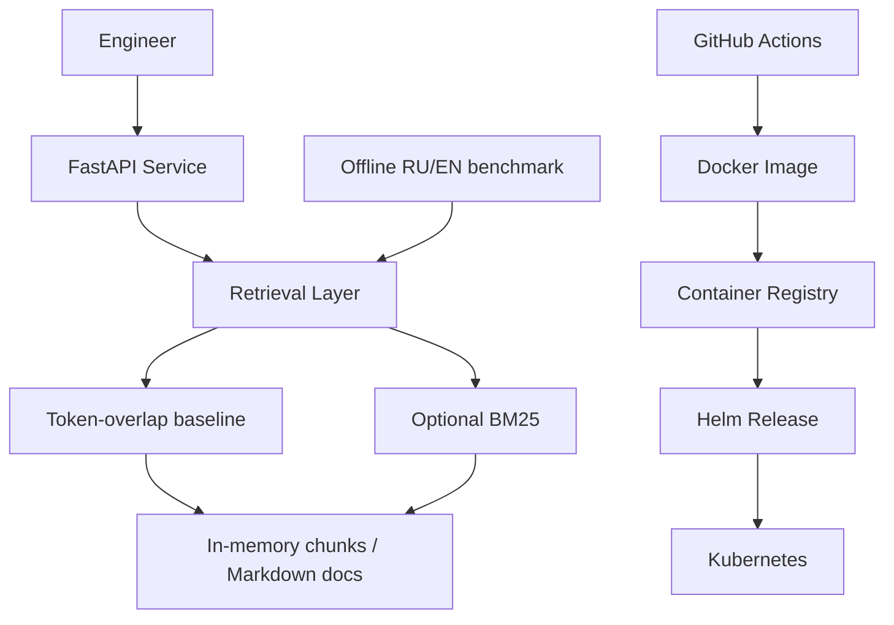

# Architecture

`RAG_RETRIEVER=overlap` preserves the original default; `bm25` opts into
precomputed term statistics. Both use the same chunking and source deduplication.
`/query` assembles summaries/actions from retrieved documents; it does not call an LLM.
The [evaluation benchmark](../evaluation/README.md) measures ranking and no-answer
behavior independently of HTTP. Embeddings, RRF, vector databases, and generation
are future stages, not parts of the current service.
