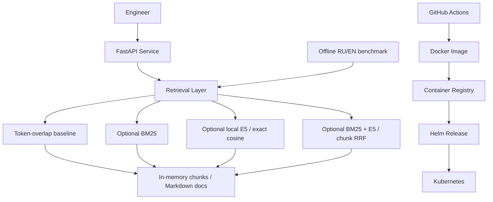

# Architecture

`RAG_RETRIEVER=overlap` preserves the original default; `bm25` opts into
precomputed term statistics. `semantic` opts into local CPU E5 embeddings and
exact cosine ranking, using separately installed optional dependencies and weights.
`hybrid` combines BM25 and semantic chunk ranks with equal-weight RRF (c=60).
Each branch retrieves `top_k * candidate_multiplier` chunks; fusion joins by position
in the shared chunk list, caps the fused pool to that depth, then deduplicates by
document path. Equal fused scores use corpus/chunk order; raw branch scores are
not summed. All four modes use the same chunking and source deduplication.
`/query` assembles summaries/actions from retrieved documents; it does not call an LLM.
The [evaluation benchmark](../evaluation/README.md) measures ranking and no-answer
behavior independently of HTTP. Embeddings are rebuilt in memory at startup/reindex;
there is no vector database or ANN. Hybrid rebuilds both branch indexes before
replacing the existing state and reuses the encoder on reindex. Its source scores
are RRF values, not cosine/confidence; an empty lexical branch does not veto semantic
candidates. Neither semantic nor hybrid implements no-answer abstention.
Generation remains a future stage.
The existing Docker/Helm/raw-manifest deployment remains lexical-only.

## Local Web Runtime

FastAPI serves the browser workspace and static files from `app/web/`.
GET `/ui/config` reads active settings; POST `/ui/config` validates a retriever,
BM25 k1/b and candidate multiplier, builds a complete replacement `RAGService`,
then swaps the reference on success. Failure preserves the previous service.
An in-process lock serializes configuration, query, info and reindex, preventing
mixed query/config snapshots or concurrent mutations. Health remains independent.
The public query JSON is unchanged; `X-RAG-Runtime` attributes a response to the
settings used under that lock. Browser score tooltips/export use that snapshot.

This is a localhost-only, unauthenticated, single-worker development workspace,
not a multi-user administration API. Changes affect all clients of that process,
are not persisted and reset to env settings after restart. Model/docs paths and
filters remain startup configuration; RRF settings remain fixed. Switching to
semantic/hybrid requires the configured local model and loads a fresh encoder;
old/new indexes can coexist temporarily during building. No external downloads
or document transmission occur in this endpoint. Deployment defaults are unchanged.
